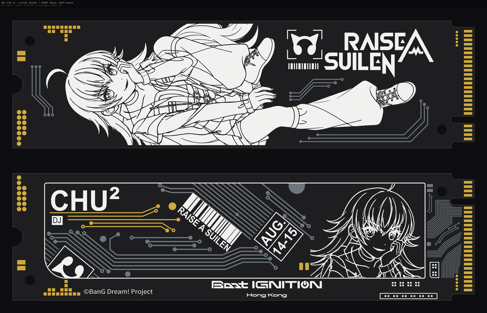

# ras-pcb-design



上方为正面，下方为背面；灰色表示阻焊下铜，金色表示开窗铜，白色表示丝印。

[下载最新 Gerber 制板包（GitHub Release）](https://github.com/zHElEARN/ras-pcb-design/releases/latest)

## 源文件

- `layout/front.json`、`layout/back.json`：最终毫米矢量几何，按铜、阻焊开窗、丝印分层。
- `config/board.json`：板框、机械孔和工艺参数；`config/checks.json`：检查阈值。
- `assets/`：最终图案使用的 SVG；`tools/`：从 SVG 重建部分布局分组的脚本。
- `src/raspcb/`：从布局生成 KiCad 和 Gerber 的工具链。

## 构建

需要 Python ≥3.12、`uv` 和 KiCad。

```sh
uv sync --locked
uv run raspcb preview
uv run raspcb build
uv run raspcb check
```
